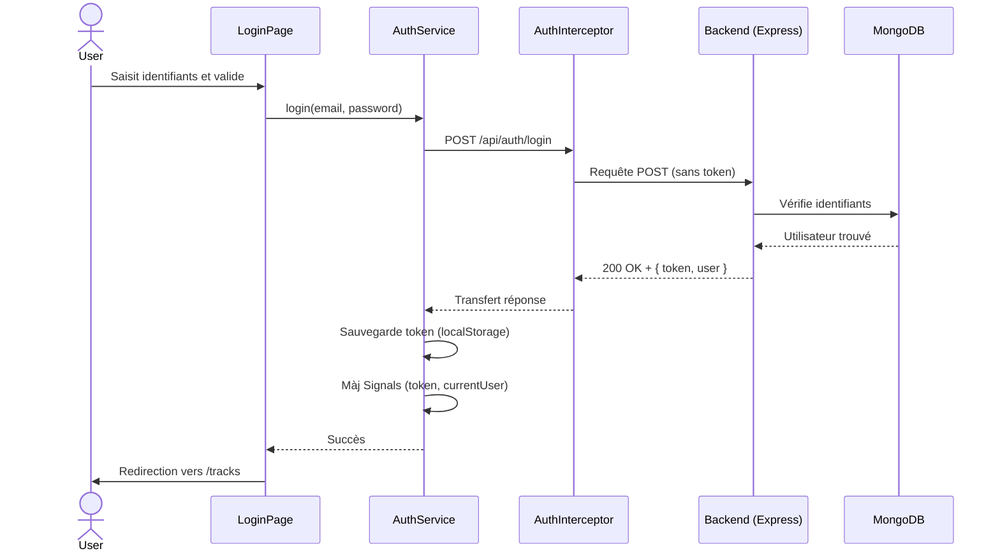
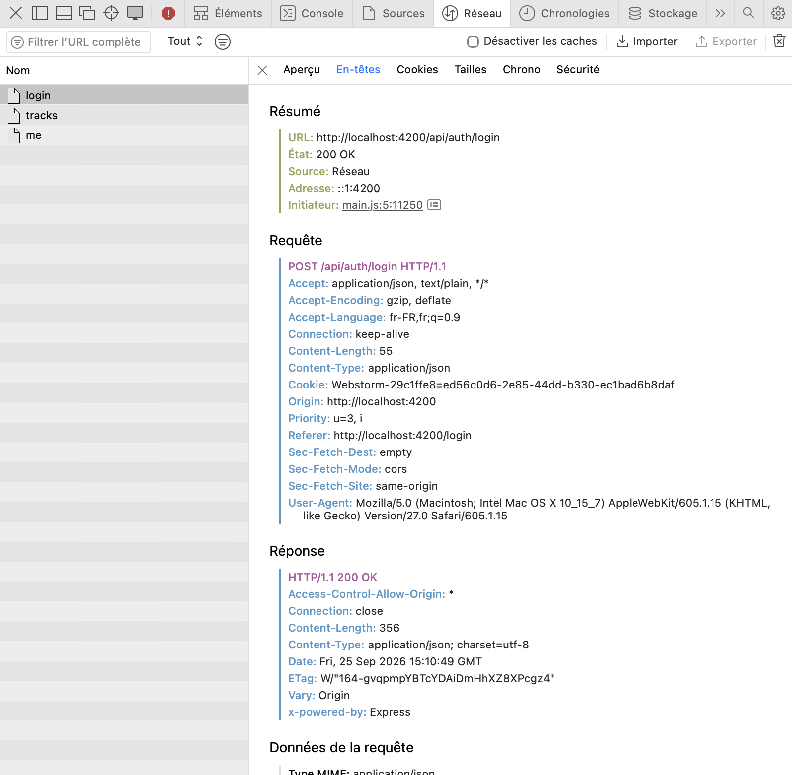
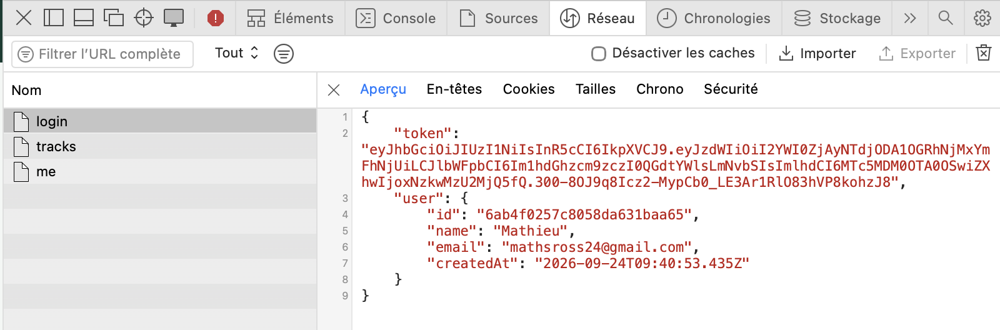
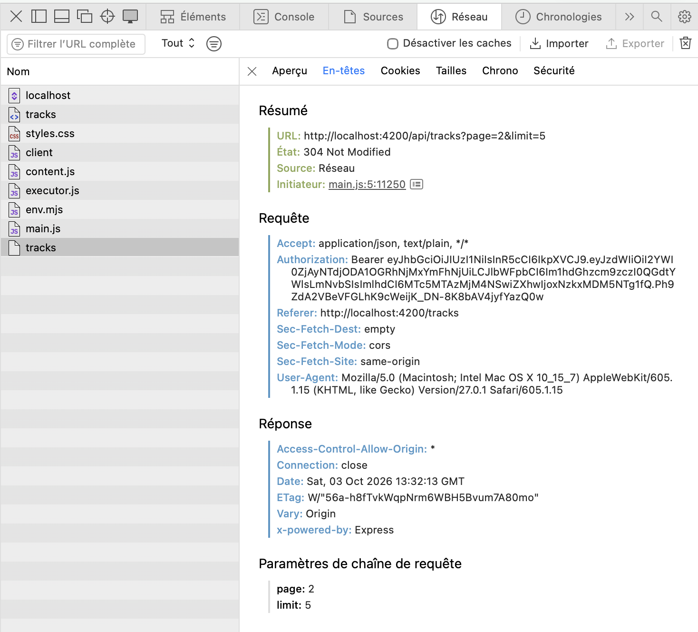
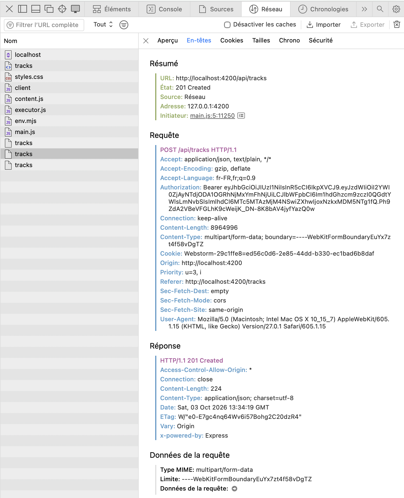
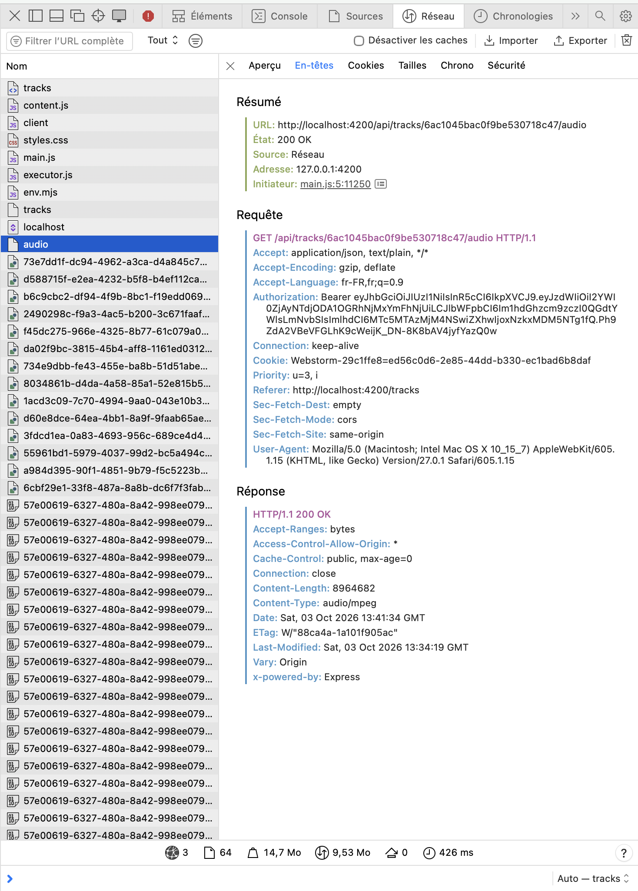

# Rapport d'usage de l'IA - TP1

Pour chaque mission, détailler et fournir des explications concernant : objectif; prompt principal; plan proposé par l'agent; vérifications réalisées par le binôme; erreurs ou propositions rejetées; fichiers effectivement modifiés; preuve de fonctionnement; ce que chaque membre sait maintenant expliquer sans l'agent.

---

## Interaction 1 - Cartographie de l'application (Mission 0)

**Objectif** : comprendre l'architecture globale du projet (front + back) sans toucher au code.

**Prompt** :
> J'ai un projet Angular + Express/Mongo, explique moi l'architecture du projet en place (backend comme frontend). Tu peux te baser sur ce qui est décrit dans la mission 0 du fichier SUJET_ETUDIANT_TP1.md. Fournis également un diagramme de séquence / flux explicatif.

**Réponse de l'IA** : l'agent a parcouru les fichiers du projet et a résumé :
- `main.ts` -> bootstrap de l'app
- `routes.ts` -> les 5 routes, dont 2 protégées par `authGuard` (`/profile`, `/tracks`)
- `auth.service.ts` -> gestion de l'authentification, Signals `token` et `currentUser`, méthodes du logout
- `auth.interceptor.ts` → ajout du `Authorization: Bearer <token>` aux requêtes si un token existe
- `app.js` (backend) → middleware `auth`, routes Express, Multer pour les uploads
- etc.

L'IA a aussi fourni le diagramme de séquence du flux de connexion :

**Tableau routes publiques et protégées** :

| Méthode | Route | Protégée ? |
|---|---|---|
| `POST` | `/api/auth/register` | Non |
| `POST` | `/api/auth/login` | Non |
| `GET` | `/api/users/me` | Oui (JWT) |
| `PUT` | `/api/users/me` | Oui (JWT) |
| `GET` | `/api/tracks` | Oui (JWT) |
| `POST` | `/api/tracks` | Oui (JWT) |
| `GET` | `/api/tracks/:id/audio` | Oui (JWT) |

**Fichiers modifiés** : aucun.

---

## Interaction 2 - Question : pourquoi un intercepteur ?

**Prompt** :
> Je comprends pas bien le rôle de l'intercepteur. Pourquoi on peut pas juste ajouter le header Authorization dans chaque appel du service directement ?

**Résumé** : l'IA a expliqué que sans intercepteur il faudrait répéter le header dans chaque méthode de chaque service (DRY). Il centralise ça = un seul fichier à modifier si le format du token change. Et l'intercepteur peut aussi intercepter les réponses (donc utile plus tard pour le 401).

**Fichiers modifiés** : aucun. C'était juste pour comprendre.

---

## Interaction 3 - Templates de validation (Mission 1)

**Objectif** : avoir les messages d'erreur par champ sur les formulaires login et register.

**Prompt** :
> Début de la mission 1 -> j'ai commencé à modifier les formulaires login et register pour ajouter les validations. Le TS est fait, maintenant fait les templates Angular (+css) pour les messages d'erreur etc.

**Ce que l'IA a fait** :
- Écrit les templates HTML avec les conditions
- Ajouté un état `loading` sur les boutons de soumission (Connexion/Inscription)
- Ajouté un `placeholder` sur les champs pour guider l'utilisateur

**Vérification** : j'ai vérifié tous les messages d'erreur par champ.

**Fichiers modifiés** : `login-page.html`, `register-page.html`.

---

## Interaction 4 - Question sur le Signal

**Prompt** :
> Pour la mission 1, il est demandé "mise à jour du Signal currentUser", c'est quoi ? comment procéder ? et pourquoi c'est mieux ?

**Résumé** : l'IA a expliqué la différence entre le localStorage qui persiste les données entre sessions, et le Signal qui est réactif mais perdu au refresh. Donc on a besoin des deux pour gérer l'état de l'utilisateur connecté.

Dans `AuthService`, la méthode `storeAuthentication()` fait les deux en même temps.

**Ce qu'on sait maintenant expliquer** : pourquoi `readonly token = signal<string | null>(localStorage.getItem('gpc_token'))` au démarrage -> on initialise le Signal avec ce qui a été persisté, pour restaurer la session après un refresh.

**Fichiers modifiés** : aucun (mode ask, modification à la main).

---

## Interaction 5 - Gestion du 401 dans l'intercepteur (Mission 1)

**Objectif** : quand le backend renvoie 401 (token invalide/expiré), nettoyer la session et revenir au login automatiquement.

**Prompt** :
> Ajoute la gestion des erreurs 401 dans l'intercepteur : si le backend répond 401 sur une route protégée, appeler logout() et rediriger vers /login.

**Ce que l'IA a modifié** : ajout d'un `catchError` dans le pipe de l'intercepteur qui vérifie `error.status === 401 && token`, puis appelle `auth.logout()` et route vers `/login')`.

**Fichiers modifiés** : `auth.interceptor.ts`.

---

## Interaction 6 - Debug token expiré au démarrage

**Prompt** :
> Quand j'ouvre l'app, avant même de me connecter, la devTool du navigateur affiche un "jwt expired" et une erreur 401 sur /api/tracks. Pourquoi ?

**Diagnostic de l'IA** : au démarrage, `AuthService` charge le token depuis `localStorage` même s'il est expiré -> le `authGuard` voit un token non-null et laisse passer -> la page tracks fait un `GET /api/tracks` avec le vieux token = 401.

**Solution proposée** : décoder le payload du JWT côté client et vérifier le champ `exp` avant de charger le token. Si expiré -> supprimer de localStorage et démarrer le Signal à `null`.

**Vérification** : après le fix, ouvrir l'app avec un token expiré en localStorage.

**Fichiers modifiés** : `auth.service.ts` (ajout de la méthode `savedToken()`).

---

## Réponses aux questions du sujet

**Quel modèle IA ?** Gemini 3.8 Flash pour la mission 0 via Google Antigravity (car modèle pas cher), et un peu de Opus 4.6 pour le mode agent.

**Consommation de tokens ?** Visible dans l'interface de Antigravity.

**Meilleur modèle pour quelle tâche ?** Modèle léger (Flash) pour les questions rapides et la recherche. Modèle lourd (Opus, Sonnet) pour le refactor et le debug.

**Où s'effectue la mise à jour du profil ?**
- Front : `ProfilePageComponent.save()` -> `AuthService.update(name)` -> `HttpClient.put('/api/users/me', { name })`: le token est ajouté automatiquement par l'intercepteur
- Back : `app.js` (route `PUT /api/users/me`) -> middleware `auth` vérifie le JWT -> `User.findByIdAndUpdate()` -> réponse 200

**Signal vs localStorage ?** Le Signal est réactif (le template se met à jour automatiquement quand la valeur change). Le localStorage persiste entre les sessions dans le navigateur, c'est simplement un stockage clé/valeur. Donc on utilise Signale pour le refresh reactif, et localStorage pour la persistance local du token.

---

## Preuves et Captures (Livrables)

### Capture Network d'une requête d'authentification

Voici la capture d'écran montrant la requête de connexion (`POST /api/auth/login`) réussie dans l'onglet Network du DevTools. 
On retrouve le code de statut 200 et la réponse du serveur avec le token JWT.

  

# Rapport d'usage de l'IA - TP2

---

## Interaction 1 - Découpage et Pagination (Mission 2)

**Objectif** : Comprendre ce qu'il manquait pour implémenter la pagination

**Prompt** :
> Liste-moi les tâches à faire pour la mission 2 sur la base du sujet

**Résumé** : L'IA a analysé le code existant et remarqué que la pagination (`TrackService`, les paramètres `page`/`limit`, et la boucle `@for` dans le HTML) était déjà gérée par le code de base fourni.
L'IA m'a donc uniquement aidé à ajouter un Signal `error` pour gérer et afficher les erreurs réseau proprement en cas d'échec du chargement.
**Fichiers modifiés** : `tracks-page.ts`, `tracks-page.html`.

---

## Interaction 2 - Validation Frontend (Mission 3)

**Objectif** : Vérifier le poids et le format du fichier avant de l'envoyer au serveur.

**Prompt** :
> Aide-moi à faire la validation frontend pour l'upload (taille < 25Mo et type audio uniquement).

**Résumé** : L'IA a conseillé de faire ces vérifications directement dans la méthode `choose()` (déclenchée à la sélection du fichier) pour checker immédiatement et retourner un message si besoin, plutôt que d'attendre l'envoie'. Ajout du Signal `uploadError` pour afficher l'erreur en rouge au-dessus du bouton.
**Fichiers modifiés** : `tracks-page.ts`, `tracks-page.html`.

---

## Interaction 3 - Mémoire et ObjectURL (Mission 3)

**Objectif** : Comprendre pourquoi le sujet demande de révoquer l'URL.

**Prompt** :
> Le sujet me demande de "révoquer l'ObjectURL finale à la destruction du composant". Pourquoi on fait ça et comment on l'implémente ?

**Résumé** : L'IA a expliqué le concept de fuite de mémoire avec `URL.createObjectURL` qui réserve de la RAM dans le navigateur pour stocker le fichier audio. Si on change de page sans détruire = la RAM n'est pas libérée.
Elle a également implémenté l'interface `OnDestroy` dans Angular proprement car je ne voyais pas comment le faire.
**Fichiers modifiés** : `tracks-page.ts`.

---

## Interaction 4 - Refonte Graphique et Affordance (Mission 3)

**Objectif** : Rendre la liste de pistes plus esthétique (Cards). Le front pur ne m'interesse pas, je le délègue à l'IA.

**Prompt** :
> Transforme la liste des pistes en de vraies Cards responsives, conformément à ce qui est demandé dans @SUJET_ETUDIANT_TP2.md . Rajoute des boutons de lecture au hover.

**Résumé** : L'IA l'a implémenté avec du CSS Grid.
**Fichiers modifiés** : `tracks-page.css`, `tracks-page.html`.

---

## Réponses aux questions théoriques (Livrables TP2)

**1. Le backend envoie-t-il le fichier entier en mémoire ou peut-il l’envoyer progressivement depuis le disque ?**
Il l'envoie progressivement depuis le disque car, dans le code backend (`app.js`), la route audio utilise `res.sendFile(audioPath)`, qui est une méthode d'Express qui gère en interne le streaming du fichier par morceaux sans le charger entièrement en RAM.

**2. Avec `HttpClient` et `responseType: "blob"`, à quel moment le composant reçoit-il généralement le fichier ?**
Angular attend que le fichier complet soit téléchargé en RAM côté client avant de déclencher le `next()` du `.subscribe()`. Le navigateur commence ensuite à le lire depuis la RAM (via l'ObjectURL).

**3. Si la bibliothèque contient 100 morceaux, les 100 fichiers audio sont-ils chargés en mémoire dès l'affichage de la liste ? Justifier la réponse à partir du code.**
Non, car :
- la pagination limite la liste envoyée au client (donc juste les métadonnées de 5 morceaux)
- le fichier audio lui-même n'est téléchargé que lorsqu'on clique sur le bouton "Lire" du morceau.

**4. Quelle différence y aurait-il avec 100 éléments `<audio>` utilisant directement une URL HTTP ?**
- le navigateur commencerait à pré-charger automatiquement les 100 fichiers audio en parallèle (du moins les métadonnées), ce qui générerait 100 requêtes HTTP d’un coup et consommerait beaucoup de bande passante et de RAM. Alors, qu'avec notre approche, on ne télécharge qu’un seul fichier, uniquement quand l’utilisateur clique sur "Lire".
- les requêtes faites nativement par une balise `<audio>` ne passent pas par le `HttpClient` d’Angular, donc l'intercepteur n’ajoute pas le token JWT et le backend refuserait toutes les requêtes avec une erreur 401.

**5. Pourquoi l'URL créée par `URL.createObjectURL` doit-elle être révoquée ?**
Cette méthode crée un lien temporaire vers des données stockées dans la RAM du navigateur.
Si on ne fait pas `revokeObjectURL()`, le navigateur conserve ces données en mémoire jusqu'à ce qu'on ferme l'onglet, ce qui finit par créer une fuite de mémoire (Memory Leak) si on lance plusieurs morceaux.

---

## Preuves et Captures (Livrables TP2)

### Capture Network de la pagination

Requête `GET /api/tracks?page=2&limit=5` visible dans l'onglet Network. On observe que le paramètre `page` change à chaque clic sur "Suiv." ou "Préc.".

### Capture Network de l'upload

Requête `POST /api/tracks` en `multipart/form-data`. 

### Lecture audio authentifiée

Pour prouver que la lecture passe bien par l'intercepteur JWT :
dans l'onglet Network, au clic sur "Lire", la requête `GET /api/tracks/:id/audio` apparaît, et dans ses Request Headers, on retrouve `Authorization: Bearer <token>`, ce qui confirme que l'intercepteur Angular a bien injecté le JWT. Sinon, sans ce header le backend refuserait la requête (401).

  

# Rapport d'usage de l'IA - TP3

---

## Interaction 1 - Conception et UX de la suppression (Mission 5)

**Objectif** : Savoir comment structurer la suppression d'une piste côté Angular : confirmation, gestion de l'état asynchrone pour bloquer les doubles clics, et notification discrète via `MatSnackBar`.

**Prompt** :
> Pour la mission 5, je dois ajouter la suppression d'une piste. Comment gérer proprement l'état dans le composant pour éviter les doubles clics et comment utiliser le MatSnackBar d'angular pour notifier le user sans bloquer l'écran ?

**Résumé de la réponse** :
L'IA a recommandé d'utiliser un Signal `deletingId` pour stocker l'identifiant de la piste en cours de suppression (ou `null` quand aucune suppression n'est en cours). Cela permet :
- De désactiver le bouton de la carte ciblée + afficher un état d'attente.
- D'empêcher les doubles clic avant réponse du serveur.
- D'injecter la snackBar pour ouvrir une notification temporaire et qui disparaît automatiquement sans bloquer l'utilisateur.
- De gérer le cas d'erreur 404 (si déjà supprimée dans un autre onglet) avec un message et un reload.

**Fichiers modifiés** :
- `tracks-page.ts` (signal `deletingId`, injection `MatSnackBar`, méthode `remove()`)
- `tracks-page.html` (bouton suppression dans `.track-actions`)
- `tracks-page.css` (styles du bouton et affichage au hover)

---

## Interaction 2 - Sécurité Frontend vs Backend (Mission 5)

**Objectif** : Comprendre la séparation de sécurité entre le client Angular et l'API Express.

**Prompt** :
> Dans le sujet de la mission 5, il est demandé d'expliquer pourquoi le guard Angular et l'interface ne suffisent pas à sécuriser la suppression. Je sais que le guard protège l'accès à la page, mais pourquoi c'est pas une vraie sécurité pour la suppression ?

**Résumé de la réponse** :
L'IA a expliqué la différence fondamentale entre ergonomie client (UX) et sécurité serveur :
- **Côté client** : le guard Angular (`authGuard`) et les conditions d'affichage ne font que guider l'utilisateur. Tout est dans le navigateur, donc un user malveillant peut ouvrir ses DevTools ou envoyer directement un `DELETE /api/tracks/:id`.
- **Côté serveur** : le middleware `auth` valide la signature du token JWT et extrait l'identité du client (`req.auth.sub`). Même si un user tente d'envoyer l'ID d'une piste appartenant à quelqu'un d'autre, le backend refuse le delete et retourne une 404 car l'`ownerId` ne correspond pas.

**Fichiers modifiés** : aucun.

---

## Réponses aux questions théoriques (Mission 5)

**Pourquoi le guard Angular et l’interface ne suffisent pas à sécuriser la suppression ?**
Le guard Angular et l'interface s'exécutent entièrement côté client (dans le navigateur de l'utilisateur). Ils n'apportent qu'un confort de navigation et peuvent être facilement contournés (modification de mémoire dans les DevTools, ou émission directe d'une requête HTTP `DELETE /api/tracks/:id` via la console, cURL ou Postman). 

La sécurité réelle est obligatoirement garantie par le backend :
1. Le middleware `auth` vérifie la validité et la signature du jeton JWT.
2. Le modèle Mongoose filtre la suppression avec le propriétaire de la piste (`Track.findOneAndDelete({ _id: id, ownerId: req.auth.sub })`), rendant impossible la suppression de la piste d'un autre utilisateur même en connaissant son ID.

---

## Interaction 3 - Implémentation de la progression d'upload (Mission 6)

**Objectif** : Faire évoluer l'upload pour afficher le pourcentage et la barre de progression.

**Prompt** :
> Fais la mission 6 : fais évoluer l'upload de piste pour afficher la progression en pourcentage avec une barre, désactiver les contrôles pendant l'envoi et gérer les états (sans upload, en cours, succès, échec).

**Ce que l'IA a fait** :
- A modifié `TrackService.upload()` pour ajouter `{ reportProgress: true, observe: 'events' }`.
- A ajouté le Signal `uploadProgress` dans le composant pour stocker le pourcentage.
- A utilisé les événements `HttpEventType.UploadProgress` et `HttpEventType.Response` dans le `subscribe()` -> mise à jour du Signal et réactivation des champs.
- A ajouté la barre HTML `<progress>` et le texte du pourcentage dans la partie d'importation.

**Fichiers modifiés** : `track.service.ts`, `tracks-page.ts`, `tracks-page.html`, `tracks-page.css`.

---

## Interaction 4 - Réinitialisation complète du formulaire après upload (Mission 6)

**Objectif** : Vider le champ de fichier natif HTML une fois l'upload terminé.

**Prompt** :
> Quand l'upload réussit, le champ du titre se vide bien, mais l'input du fichier audio garde toujours le nom de l'ancien fichier affiché à l'écran. Comment corriger ca ?

**Ce que l'IA a fait** :
- A expliqué que mettre la variable `this.file = undefined` ne réinitialise pas le DOM de l'élément `<input type="file">` natif du navigateur.
- A ajouté une référence locale `#fileInput` dans le HTML et injecté `@ViewChild('fileInput')` dans le TypeScript.
- Dans le bloc de succès de l'upload, a ajouté `this.fileInput.nativeElement.value = ''` pour effacer le nom du fichier sélectionné et remettre le form à zéro.

**Fichiers modifiés** : `tracks-page.html`, `tracks-page.ts`.

---

## Interaction 5 - Compréhension du calcul de progression (Mission 6)

**Objectif** : Comprendre le fonctionnement des événements de progression et préparer la question du sujet.

**Prompt** :
> Comment le navigateur et Angular calculent concrètement le pourcentage de progression ? Et pourquoi on ne peut pas traiter cette requête comme un appel HTTP classique (question de la mission 6 dans @SUJET_ETUDIANT_TP3.md) ?

**Résumé de la réponse** :
- Le navigateur découpe le fichier multipart en paquets réseau. À chaque envoi de paquet, l'API réseau émet un événement contenant les octets déjà transmis (`loaded`) et le poids total (`total`).
- Contrairement à un appel d'API classique qui n'émet qu'une seule valeur finale (JSON de réponse) puis se termine, ici le `HttpClient` émet un flux continu de plusieurs objets `HttpEvent` différents. Il faut aussi filtrer par `event.type` pour séparer les événements de progression de la réponse finale.

**Fichiers modifiés** : aucun.

---

## Réponses aux questions théoriques (Mission 6)

**Expliquer pourquoi un upload avec progression ne se traite pas exactement comme une requête HTTP qui émet uniquement une réponse finale.**

Une requête HTTP fonctionne sur le modèle requête/réponse unique. Avec la progression d'upload (`reportProgress: true` et `observe: 'events'`), le comportement change :
1. L'Observable envoie plusieurs notifications pendant le transfert (`HttpEventType.Sent`, puis une suite d'événements `UploadProgress` à chaque paquet réseau, et enfin `Response`).
2. Le flux ne contient pas directement la ressource, mais des objets `HttpEvent`. Le code du composant doit donc séparer les étapes de progression de la réponse finale.

---

## Interaction 6 - Découverte des tests Angular et cadrage (Mission 7)

**Objectif** : Comprendre le fonctionnement des TU Angular et définir la liste des tests à écrire selon le sujet.

**Prompt** :
> Pour la mission 7, je dois faire des tests sur la partie frontend (angular). Je ne connais pas, donc dans un premier temps explique moi comment les tests se font avec Angular. Pour ne pas impacter le backend il faudra un/des mocks ? Comment (explique, ne code pas) ? Et enfin, d'après les consignes, analyse et propose les tests qui peuvent être mis en place (liste).

**Résumé de la réponse** :
L'IA a expliqué les bases du testing Angular :
- L'utilisation de `TestBed` qui initialise un env de test et instancie les services avec isolation.
- Le principe du mock HTTP avec `provideHttpClientTesting()` et `HttpTestingController` : les requêtes réseau sont interceptées en mémoire et le test fournit lui-même la réponse attendue -> le backend jamais utilisé.
- L'IA a proposé une première liste de tests issus du sujet.

**Fichiers modifiés** : aucun.

---

## Interaction 7 - Complément de cas limite et implémentation (Mission 7)

**Objectif** : Corriger la liste proposée en ajoutant le cas sans token, puis implémenter les suites de tests.

**Prompt** :
> Dans ta proposition, tu as prévu de tester l'ajout du Bearer token, mais tu as oublié le cas où l'utilisateur n'est pas connecté. Il faut aussi vérifier qu'aucun header Auth n'est ajouté si le token est null. Ajoute ce test et implémente l'ensemble des tests.

**Ce que l'IA a fait** :
- A créé `auth.service.spec.ts` pour tester l'appel `POST /api/auth/login` avec le bon corps et la mise à jour des Signals.
- A créé `track.service.spec.ts` pour tester les paramètres `page` et `limit` sur `list()` ainsi que l'appel `DELETE` sur `delete()`.
- A créé `auth.interceptor.spec.ts` en incluant bien les **deux cas** : avec token (en-tête présent) et sans token (aucun en-tête ajouté).
- A configuré Vitest dans `src/test-setup.ts` et le script `npm test`.

**Fichiers créés / modifiés** :
- `src/app/shared/services/auth.service.spec.ts`
- `src/app/shared/services/track.service.spec.ts`
- `src/app/shared/interceptors/auth.interceptor.spec.ts`
- `src/test-setup.ts`
- `frontend-starter/package.json`

---

## Rapport des tests (Livrables TP3 - Mission 7)

Exécution via `npm test` : **3 suites de tests, 5 tests passés avec succès**.

| Test | Fichier | Résultat attendu | Résultat observé |
|---|---|---|---|
| `login() utilise POST /api/auth/login avec le bon corps` | `auth.service.spec.ts` | Requête `POST /api/auth/login` avec body `{ email, password }`, mise à jour du Signal `token` | ✅ Passé (8ms) |
| `list() transmet page et limit` | `track.service.spec.ts` | Requête `GET /api/tracks?page=2&limit=10`, paramètres d'URL conformes | ✅ Passé (9ms) |
| `delete() appelle DELETE /api/tracks/:id` | `track.service.spec.ts` | Requête `DELETE /api/tracks/track-123`, statut 204 simulé | ✅ Passé (1ms) |
| `ajoute Authorization lorsqu’un token existe` | `auth.interceptor.spec.ts` | En-tête `Authorization: Bearer <token>` injecté sur la requête sortante | ✅ Passé (8ms) |
| `ne met pas Authorization si aucun token n’existe` | `auth.interceptor.spec.ts` | Aucun en-tête `Authorization` ajouté si `token === null` | ✅ Passé (1ms) |
